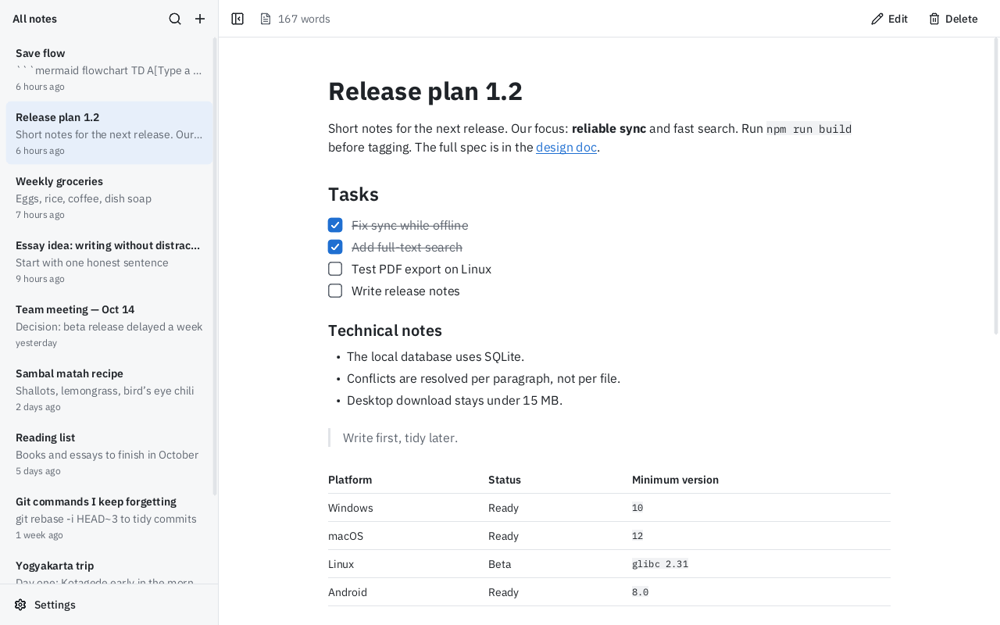
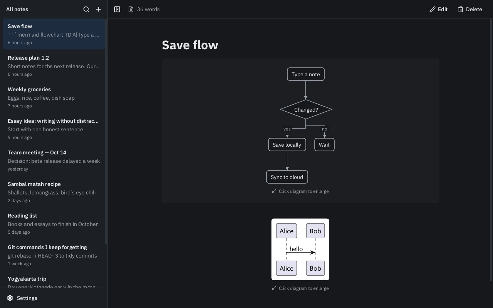

# TilDown

**TilDown** (Tilde + markdown) is a fast, lightweight markdown notes app in the spirit of Simplenote and Notational Velocity. It opens instantly and you can start typing right away. Your notes are plain `.md` files.

Built from scratch in Rust on **wgpu + winit**. One codebase runs on desktop and the web, with Android planned. There is no WebView, no Electron and no JavaScript editor.




## Features

- **Instant**: the window appears in about 150 ms, uses 0% CPU when idle and about 30 MB of RAM. It stays fast with 10,000 notes: they load in under 1 s and search takes 1–3 ms per keystroke.
- **Plain files**: each note is a `.md` file in `Documents/TilDown`. Saving is atomic (write, fsync, rename), with autosave 1 s after you stop typing. You can sync the folder with Syncthing, Dropbox, iCloud and similar tools.
- **Notational Velocity search**:
  - Type to filter your notes.
  - Enter opens the top match, or creates a new note if nothing matches.
  - Matches are highlighted inside the note. Step through them with F3 or Shift+F3.
- **Editor**: markdown highlighting in the style of iA Writer, list and task continuation, undo/redo, and IME input.
- **Read mode**:
  - Headings, lists, task checkboxes you can click, quotes, code blocks, tables, local images and links.
- **Native diagrams**, with no mermaid.js, Java or Graphviz:
  - **Mermaid**: flowcharts and sequence diagrams.
  - **PlantUML**: sequence, activity, class, object, use case, component, state, mindmap, WBS, gantt, timing, JSON, YAML, nwdiag, salt, EBNF, regex, Chen ER, chart, git, wire, ditaa and more.
  - Click a diagram or an image to open a viewer with zoom, pan and pinch. **Download** saves the image, or the diagram as a PNG, to your Downloads folder.
- **Images**: paste a screenshot (Ctrl+V) or drop image files onto the window. They are saved to `assets/` in your notes folder and linked into the note. On the web they are kept in browser storage. Images are not synced yet.
- **Import**: drop `.md` or `.txt` files onto the window to add each one as a new note. The original file is left unchanged. Works in the desktop app and on the web.
- **Sync** across devices through your own Cloudflare Worker on the free plan, so your notes never pass through anyone else's server. See [Sync](#sync).
- **Trash**: deleted notes can be restored for 30 days.
- **Settings**: light, dark or system theme, text size, line width, and whether notes open in edit or read mode.

## Install on Windows

Download `TilDown-<version>-setup.exe` from [Releases](https://github.com/goldalworming/tildown/releases/latest) and run it. Administrator rights are not needed. If you would rather not install anything, use `TilDown-<version>-portable.exe`, which is the same app as a single file.

Notes are kept in `Documents\TilDown`, and uninstalling does not delete them.

## Install on your phone

The web version is a Progressive Web App (PWA), so you can install it like a regular app:

1. Open **https://goldalworming.github.io/tildown/** on your phone.
2. Install it:
   - **Android (Chrome)**: menu ⋮, then **Install app** (or **Add to Home screen**).
   - **iPhone (Safari)**: the Share button, then **Add to Home Screen**.

Once installed, TilDown opens full screen, works offline, and keeps your notes on the device.

On a phone:
- Tap a note to open it, and use the panel button at the top left to go back to the list.
- Swipe to scroll.
- Tap the text to bring up the keyboard.

Use [Sync](#sync) to keep your notes in step with the desktop app.

The site is built and published by `.github/workflows/web.yml` on every push to `main`. If you fork the repo, enable this once under **Settings → Pages → Source: GitHub Actions**.

## Sync

Sync is optional. Without it, TilDown works fully offline with local files.

TilDown syncs through a small server that you deploy to **your own** Cloudflare account. It is a Worker plus a SQLite Durable Object, and the free Workers plan is enough. Your notes stay in your account.

1. In TilDown, open **Settings → Sync** and press **Generate**. A new random token is filled in and copied to the clipboard.
2. Press **Deploy ↗**, which opens the button below. Sign in to Cloudflare and paste the token when you are asked for `TOKEN`. When the deploy finishes, copy the Worker URL (for example `https://tildown-sync.<you>.workers.dev`) into **Server URL**.

   [](https://deploy.workers.cloudflare.com/?url=https://github.com/goldalworming/tildown/tree/main/server)

3. Press **Connect**. Then press **Copy code**: it copies the server URL and token as one code. On your other devices, paste that code into **Server URL** and press **Connect**. Keep the code private, because it gives full access to your notes.

How syncing works:
- TilDown sends changes a few seconds after you save, checks for new changes every minute while the window is active, and syncs when you switch away.
- If the same note was edited on two devices, both versions are kept. The other one appears as a new note titled "… (conflict)".
- Notes deleted on one device go to the Trash on the others.

To deploy by hand instead of using the button:

```sh
cd server
npm install
npx wrangler deploy
npx wrangler secret put TOKEN
```

To run the server locally, put `TOKEN=...` in `server/.dev.vars`, then run `npm run dev`. `npm test` runs the sync rules against SQLite.

Notes on security:
- Anyone who has the token can read and change your notes, so keep it secret.
- The app stores the token in `.sync` inside your notes folder.
- Don't also sync that folder with another tool such as Dropbox or Syncthing, because the two sync methods would conflict.

## Keyboard shortcuts

| Keys | Action |
|---|---|
| Ctrl+N | New note |
| Ctrl+F / Ctrl+L | Search |
| Ctrl+E | Toggle edit / read |
| Ctrl+S | Save now |
| Ctrl+\ | Toggle sidebar |
| F3 / Shift+F3 | Next / previous search match |
| Esc | Close search, dialog or viewer |

## Build

You need [Rust](https://rustup.rs) (stable).

```sh
cargo run --release          # desktop (Windows, macOS, Linux)
cargo test
```

Set `MARKDOWN_DIR=<path>` to use a different notes folder.

### Release

Push a tag (`git tag v0.1.0 && git push origin v0.1.0`). The **Release** workflow builds the Windows installer with [Inno Setup](https://jrsoftware.org/isinfo.php) (`installer/tildown.iss`) and publishes it with a portable exe.

### Web

The web build uses WebGPU, falling back to WebGL2. Notes are stored in the browser's OPFS.

```sh
rustup target add wasm32-unknown-unknown
cargo install wasm-bindgen-cli   # same version as in Cargo.lock
sh web/build.sh
python -m http.server -d web 8080
```

## Project layout

```
src/
  doc.rs        editor core: text, cursor, selection, undo
  store.rs      notes folder: load, atomic save, rescan, search, trash
  md.rs         markdown highlighting and read-mode blocks (pulldown-cmark)
  text.rs       fonts (ab_glyph), glyph atlas, layout, hit-testing
  gpu.rs        wgpu quad pipeline
  app.rs        winit shell and the whole UI
  mermaid.rs    Mermaid parser and layout
  plantuml/     PlantUML parsers and layouts
  sync.rs       sync client (push/pull, conflicts)
  web.rs        wasm: OPFS mirror, clipboard, links
web/            index.html and build script
server/         sync server: Cloudflare Worker + Durable Object
docs/PRD.md     product requirements (Indonesian)
```

## Credits

- Fonts: [IBM Plex](https://github.com/IBM/plex) and [Noto Sans](https://fonts.google.com/noto), both under the SIL Open Font License.
- Icons: [Lucide](https://lucide.dev) (ISC).

## License

[MIT](LICENSE). Bundled fonts and icons keep their own licenses (see Credits).
